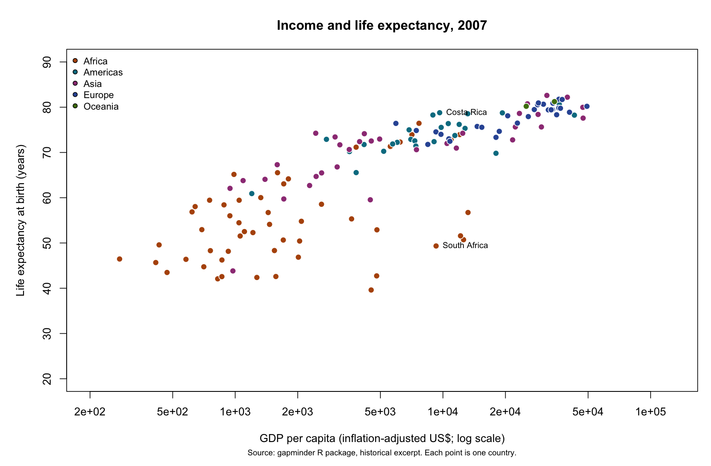

# Income and Life Expectancy Across Countries

## Project Overview

This project uses R and Plotly to explore how the relationship between GDP per capita and life expectancy varies across countries and over time. It uses the historical Gapminder excerpt: 142 countries observed every five years from 1952 to 2007.

The main figure includes a year slider, continent legend filters and country hover details. A supplementary dropdown figure follows five selected countries through all twelve observations. Both figures use fixed axes and a logarithmic GDP scale.

## Repository Structure

```text
blogpost7_interactive_data_visualization/
├── code/
│   └── blogpost7_all_process.R
├── data/
│   ├── raw/
│   ├── processed/
│   └── results/
├── figures/
│   ├── index.html
│   ├── interactive_plot.html
│   ├── country_trajectories.html
│   ├── preview_2007.png
│   ├── post/
│   └── evidence/
├── .gitignore
├── README.md
└── blogpost7_interactive_data_visualization.Rproj
```

- **code/**: one complete R script for package setup, input checks, analysis, figures, article generation and output validation.
- **data/raw/**: original input CSV, source documentation and source package version.
- **data/processed/**: complete analysis table with log10 GDP per capita.
- **data/results/**: computed summaries, country cases, article claim values and R environment information.
- **figures/**: interactive HTML outputs, static preview and a standalone article page.
- **figures/post/**: generated English article in Markdown and Quarto formats, approximately 640 words.
- **figures/evidence/**: six actual interaction screenshots, data checks, captured run logs, Plotly specifications, checksums and rubric evidence map.

## Reproducibility

Open `blogpost7_interactive_data_visualization.Rproj` in RStudio. From the repository root, run:

```r
source("code/blogpost7_all_process.R")
```

Or run `Rscript code/blogpost7_all_process.R` from the repository root. Missing packages are installed automatically on the first run (CRAN access required). R 4.5 or a compatible version is recommended. Exact versions are recorded in `data/results/sessionInfo.txt` and `data/results/package_versions.csv`. Self-contained HTML export needs Pandoc, which RStudio normally bundles; outside RStudio, put Pandoc on PATH or configure `RSTUDIO_PANDOC`.

The analysis checks nine input conditions, generates all numerical results and figures, and inserts computed values into the article. It requires no API key or data download. To change the article, edit its prose in section 6 of `code/blogpost7_all_process.R` and rerun the script. Set `refresh_data <- TRUE` only to refresh the CSV from the installed gapminder package; ordinary replication uses the committed snapshot.

Open [the article page](figures/index.html), [the main interactive figure](figures/interactive_plot.html), or [the country trajectories](figures/country_trajectories.html) in a browser after downloading the repository. JavaScript is included in each figure, so no CDN or running R session is required. GitHub's file preview does not execute the interactive HTML.

## Main Findings

- The unweighted median country life expectancy rises from 45.1 years in 1952 to 71.9 in 2007.
- In 2007, Costa Rica and South Africa have GDP per capita of approximately $9,645 and $9,270, but life expectancy differs by 29.4 years.
- From 1992 to 2007, South Africa's GDP per capita rises about 28.3% while life expectancy falls about 12.5 years.

Full-precision evidence is in `data/results/article_claims.csv`, `country_cases.csv` and `year_summary.csv`. The analysis is descriptive and does not establish causal effects. Country medians are not population-weighted global estimates; national averages conceal within-country differences.



## Data Sources

Data are from the historical `gapminder::gapminder` excerpt (source package 1.0.1), not a current global census. The package describes GDP per capita as inflation-adjusted US dollars, but its help page does not specify the price base; this project retains the published units without asserting an unsupported base year. Life expectancy is measured at birth in years.

- [Gapminder R dataset documentation](https://jennybc.github.io/gapminder/reference/gapminder.html)
- [Gapminder data](https://www.gapminder.org/data/)
- [Full source and measurement notes](data/raw/SOURCES.md)

## Validation Evidence

See [the evidence map](figures/evidence/rubric_checklist.md) and [browser validation record](figures/evidence/browser_validation.md). Numerical checks cover all twelve slider years for all five continents and all five country trajectories. Screenshots document actual local browser interactions; they are supplementary to the functional HTML and are not regenerated by the analysis script.

## Publication and Submission

This repository contains reproducible analysis and evidence. `figures/index.html` is ready to be hosted or incorporated into the existing course blog; its two interactive figures must be embedded or linked from the published post. A GitHub repository upload does not by itself publish the blog. Submit the actual published blog URL and this repository URL.

Repository: https://github.com/liyujing-byte/blogpost7_interactive_data_visualization
